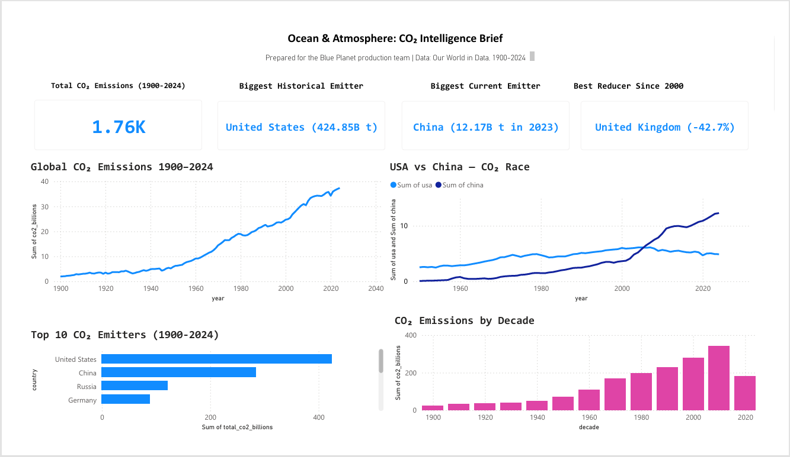

# 🌍 Ocean & Atmosphere: CO₂ Intelligence Brief

> A data brief for a wildlife documentary team: **125 years of CO₂ emissions (1900–2024) across 215 countries and territories**, showing how emissions grew, who drove them, and where the story should focus. Built with Python, SQL and Power BI.


---

## 🎬 The brief

*"We're filming a documentary on climate change. Show us, with data, how the planet got here and where the story needs to focus."*

(A hypothetical brief, used to frame the analysis for a non-technical audience.)

## 📌 Key findings

| # | Finding | Evidence |
|---|---|---|
| 1 | **Annual emissions rose 19-fold** | From 2.0 billion tonnes in 1900 to **37.4 billion tonnes in 2024** |
| 2 | **The post-war decades were the turning point** | Annual emissions grew by 8.7 billion tonnes between 1950 and 1970, more than twice the growth of the previous 50 years (3.8 billion) |
| 3 | **Two countries dominate the history** | The **United States** is the largest cumulative emitter (425 billion tonnes since 1900, 24% of the total). The US and China together account for **40%** of all emissions since 1900. |
| 4 | **China overtook the US in 2006** | By 2024 China emitted **2.5×** as much as the US each year (12.3 vs 4.9 billion tonnes) |
| 5 | **The UK made the deepest cut in the G7** | UK emissions fell **45%** between 2000 and 2024, ahead of Germany (−36%), Italy (−36%) and France (−35%) |
| 6 | **The pandemic dip was brief** | Global emissions fell **4.3%** in 2020 (35.8 → 34.3 billion tonnes) and were back above the 2019 level in 2021 |

---

## 📊 Dashboard



The interactive Power BI dashboard ([`ocean-health-dashboard.pbix`](ocean-health-dashboard.pbix)) includes:
- Headline cards: total emissions, biggest historical and current emitters, and the biggest G7 reducer
- Global CO₂ trend, 1900–2024
- USA vs China emissions race since 1950
- Top 10 cumulative emitters
- Emissions by decade

---

## 🔧 How it works

1. **Clean (Python, `code.ipynb`):** load the Our World in Data file, rename columns, keep 1900 onwards, and **remove aggregate rows** such as *World*, continents and income groups. Those rows have `OWID_` codes rather than 3-letter country codes, and leaving them in would double-count emissions.
2. **Load (`load_sql.py`):** write the clean data into a SQLite database.
3. **Analyse (`export_sql.py`):** four SQL queries produce the dashboard tables: yearly totals, top 10 emitters, USA vs China, and emissions by decade.
4. **Visualise (Power BI):** the dashboard reads the four CSVs in `output/`.

## 🗂️ Repository structure

```
Ocean-Health-CO2-Intelligence/
├── annual-co2-emissions-per-country.csv   # raw data (Our World in Data)
├── code.ipynb                             # cleaning + exploratory analysis
├── load_sql.py                            # load clean data into SQLite
├── export_sql.py                          # SQL queries → dashboard tables
├── output/
│   ├── co2_clean.csv                      # cleaned country-level data
│   ├── yearly_totals.csv
│   ├── top10_emitters.csv
│   ├── usa_vs_china.csv
│   └── emissions_by_decade.csv
├── ocean-health-dashboard.pbix            # Power BI dashboard
├── dashboard-preview.PNG
├── requirements.txt
└── README.md
```

## ▶️ How to run

```bash
git clone https://github.com/abir110/Ocean-Health-CO2-Intelligence.git
cd Ocean-Health-CO2-Intelligence
pip install -r requirements.txt
jupyter nbconvert --to notebook --execute code.ipynb   # creates output/co2_clean.csv
python load_sql.py                                     # creates output/ocean_health.db
python export_sql.py                                   # creates the four dashboard CSVs
```

To refresh the dashboard on a new machine, open the `.pbix` file and point the data source at your `output/` folder (**Transform data → Data source settings → Change source**).

## ⚠️ Notes

- Emissions are **fossil CO₂ from fuels and industry** as reported by Our World in Data, in tonnes. Land-use change is not included.
- The **2020s decade is incomplete** (2020–2024 only), so its decade total is not comparable with full decades.

## 📚 Data source

[Our World in Data, CO₂ and Greenhouse Gas Emissions](https://ourworldindata.org/co2-emissions), based on the Global Carbon Project.

---

**Author:** Abir Alam Srabon · MSc Data Science, Aston University · [LinkedIn](https://www.linkedin.com/in/abir-alam-srabon) · [GitHub](https://github.com/abir110) · [Portfolio](https://abir110.github.io)
